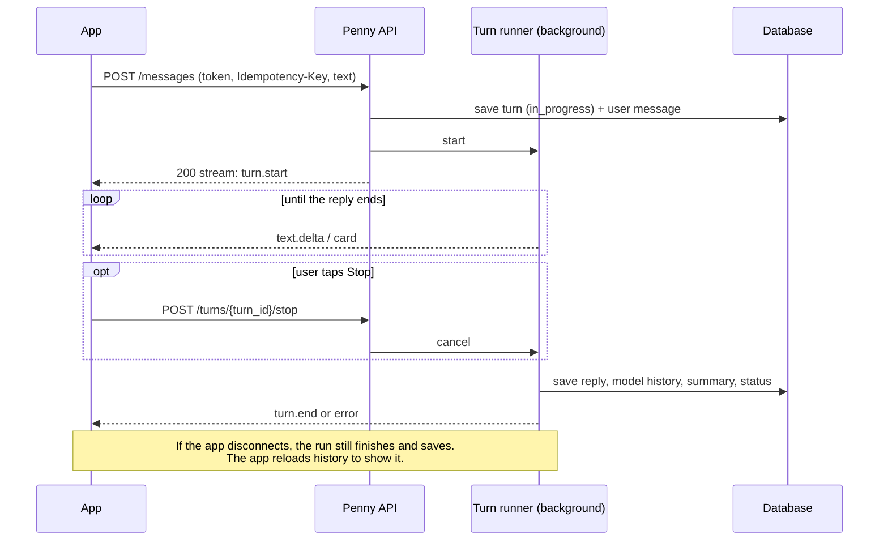

# Architecture

How Penny is put together, why it's built that way, and the API a client
uses. [Features](features.md) describes what it does, and
[Known limitations](known-limitations.md) describes where it falls short.

## The shape of the service

Penny is one FastAPI process. A message comes in over HTTP, the conversation
service saves it, and a background task runs the agent and streams events back
through a queue. The agent calls tools, which call domain services, which
query SQLite. Three diagrams cover the moving parts:

- [System overview](diagrams/system-overview.md): the API, the turn runner,
  storage, the models and tracing, following one message through.
- [The agent loop](diagrams/agent-loop.md): what happens before each model
  request, how tools are guarded, and how a turn ends and is saved.
- [Content updates](diagrams/content-updates.md): how documents are published
  and read, and how that differs from application data.

The code is organized by domain (`accounts`, `catalog`, `memory`,
`conversation`, `auth`), each with its own models, repository, service and
routes where it needs them. Routes handle HTTP, services hold the use cases,
repositories hold the queries, and tools are thin adapters from the agent to
the services. FastAPI and Pydantic AI types stay out of services and
repositories. `app.py` is the only place that reads settings and wires
dependencies, which is also how tests swap in scripted models, a fixed clock
and an in-memory tracer.

Content ingestion is a separate package. It and the service both depend on
`content_bundle`, which owns the content table, and neither imports the other.

## Design choices

Each choice below says what it buys and what it costs.

### One continuous conversation per user

There's no conversation ID. The verified token identifies the user, and the
user has one ongoing chat, so there's nothing in a URL to tamper with and the
app never has to manage sessions.

*Cost:* no "new chat", and topics mix. Compaction, saved guidance and history
search carry the long-running context instead.

### Pydantic AI, with its Harness add-on

Typed dependencies scope every tool to the verified user. Streaming,
cancellation, usage limits and test models come with the framework, and the
Harness adds tool-result clearing, summarizing compaction and context-usage
reporting.

*Cost:* the Harness is young and changes quickly. It's pinned to an exact
version, and the compaction tests guard the behavior Penny depends on.

### Two records of the conversation

The transcript (`messages`) holds what the user saw: their text, Penny's
text and cards, in order. The model history (`model_messages`) holds the
framework's messages: prompts, replies, tool calls and results. Both are
append-only. Clearing and compaction change only what's sent from the model
history, and a framework upgrade can't break an old transcript.

*Cost:* some text is stored twice. Both are written in the same transaction
at the end of a turn.

### Account context goes with each request, never into history

The user's name, linked school, saved guidance and local time are built once
per turn and inserted into each outgoing model request, account context
before the history and local time just before the turn's prompt. Nothing
inserted this way enters the stored history or a summary, so each request
sees current data and nothing goes stale.

*Cost:* a few hundred tokens per request, mostly covered by prompt caching.

### Clear, then summarize, and never truncate silently

Before each model request, if the history is over 75% of its token budget,
old tool results are replaced with a placeholder. The tool call itself stays,
so the model can run it again. If the history is still over the threshold,
older messages are summarized by the compaction model using a fixed template.
A summary missing any of the template's `##` headings is retried once and
then fails the turn. The summary is saved with the ID of the last message it
covers, so later turns load the summary plus everything after that point.

Summarizing at 75% rather than near the limit means more summarization calls,
but leaves room for a tool-heavy turn.

*Cost:* a summary can lose detail. History search, saved guidance and the
required headings reduce that risk without removing it.

### Narrow tools for data, whole documents for knowledge

Structured data sits behind typed, user-scoped queries that return totals and
cursors, so "how many" questions are answered by the database rather than the
model counting. The program knowledge is a few short documents, small enough
to send whole, which is simpler and more reliable than retrieval at this size.

*Cost:* retrieval becomes necessary once the documents grow, and product
search is literal text matching.

### Cards from database records

The model never writes product details. It calls `show_products` or
`show_promotions` with IDs and a heading, and the server builds each card
item from the database, so names, prices and images can't be invented.
Unknown IDs, avoided products and inactive promotions are refused and no card
is shown.

*Cost:* the model could still pick a real ID it never looked up.

### Content as published data, read once per turn

Persona, scope, safety policies, knowledge, the greeting and the summary
template are Markdown files listed in a manifest. Publishing normalizes them,
hashes them and writes new versions into a table in one transaction. Each turn
reads one snapshot of the active set and records its version, and a content
change applies from the next turn without a deploy or restart.

*Cost:* anything published as instructions is effectively part of the prompt,
so whoever can publish controls Penny's behavior.

### Explicit memory, saved immediately

Penny saves a preference only when the user asks it to, and says what it
saved. The avoid list is enforced inside the catalog queries and card checks,
not by asking the model to filter. Writes happen right away with no
confirmation step, which is acceptable because the only things a tool can
change are the user's own notes and avoid list.

*Cost:* preferences mentioned in passing aren't saved, and can fade from
context once older history is summarized.

### Two models, and no provider-side state

Chat uses one model and summarizing uses a cheaper one, each a setting.
Penny owns the conversation state, so every request, the summarizer's
included, opts out of provider storage, and provider-specific code lives in
one adapter.

*Cost:* Penny is responsible for all of its own context management.

### Stop keeps what happened, and a disconnect isn't a stop

Stop cancels the run and saves whatever was already said and done. The next
message continues from there, with the framework closing any interrupted tool
calls. Generation runs in a background task, so a dropped connection on a
phone doesn't lose the answer: it finishes, saves, and appears when the app
reloads history.

*Cost:* a stopped reply's partial text stays in context.

### SQLite and Docker

One command runs everything, with only Docker to install. The data layer is
async throughout, so a managed database is mostly a matter of configuration
and migrations.

*Cost:* one instance only, and history search uses SQLite's FTS5.

### Tests for what's deterministic, evals for what isn't

The test suite runs with scripted models and no network. Two small real-model
evals check policy selection and answer quality, and run only on request.

*Cost:* the evals are spot checks, not a calibrated benchmark.

## Conversation design

- **Stay on purpose.** A scope charter lists what Penny helps with: products,
  Bonus Pennies, referrals and the app itself. Outside that, or when its
  documents and tools don't have the answer, it says so and points to Greenpenny
  support rather than guessing.
- **Ground every fact.** Program facts come from the knowledge documents.
  Product, promotion, purchase and account facts come from tools. Products
  appear only as cards.
- **Ask before recommending.** When something important is missing, such as
  what the family likes or what to avoid, Penny asks first. Then it uses what
  the user said, their purchases and their saved guidance. With little to go
  on, it falls back to what's popular at the user's school.
- **Write for a phone.** Short paragraphs, which the client shows as separate
  bubbles, lists for steps, and a polite close.
- **Do no harm.** The always-loaded safety core tells the model to read the
  matching policy before answering anything about health, allergies, diet,
  children's safety or distress.
- **Newer guidance wins.** Saved notes are listed oldest first, and the model
  is told to prefer the newer one when two conflict.
- **Treat user text as data.** Account context, saved notes, summaries and
  history-search results reach the model labelled as information, never as
  instructions. Summaries record requests as reported speech ("The user asked
  Penny to…") so a stored request can't later act as a command.

## The API

The machine-readable contract is the generated OpenAPI document: a running
service serves it at `/openapi.json`, with interactive docs at `/docs`, and
[tests/penny/openapi.json](../tests/penny/openapi.json) is a committed
snapshot that a test keeps in step with the code. This section covers what
OpenAPI can't express: the stream, the send rules and how turns end.

### Basics

- Base path `/v1/conversation`. JSON field names are `snake_case`.
- Times are ISO 8601 in UTC, such as `2026-11-19T18:03:12.418204+00:00`.
- Turn and message IDs are opaque strings.
- The user's time zone comes from their account (an IANA name such as
  `America/Los_Angeles`, or the configured default). Penny uses it for the
  local time it gives the model and to read dates like "last Tuesday".

### Authentication

Every `/v1` request carries `Authorization: Bearer <token>`. Penny checks the
RS256 signature against a public key, requires `exp`, `iss`
(`greenpenny-auth`), `aud` (`penny`) and `sub`, takes `sub` as the user ID
and confirms the user exists. It keeps no session. Asking for another user's
turn or message returns `404`, the same as an ID that doesn't exist.

Login is out of scope. The demo page gets a token from `POST /demo/sessions`,
which signs the same kind of token an identity service would issue, and every
request then goes through the normal verification.

### Errors

Before a response starts streaming, an error is an HTTP status with a JSON
body:

```json
{"error": {"code": "turn_in_progress", "message": "another reply is in progress", "turn_id": "9f2c…"}}
```

| Status | `code` | When |
|---|---|---|
| 401 | `not_authenticated` | Missing, malformed, expired or invalid token, or an unknown user. Sent with `WWW-Authenticate: Bearer`. |
| 404 | `not_found` | The turn or message doesn't exist or isn't the caller's. |
| 409 | `turn_in_progress` | Another reply is running for this user. Includes `turn_id`. |
| 422 | `invalid_request` | A field failed validation; `message` names it. |
| 422 | `idempotency_key_reused` | The `Idempotency-Key` was already used with different text. |

Once a send's `200` stream has started, a failure arrives as a single `error`
event instead.

### Endpoints

| Route | Purpose |
|---|---|
| `GET /v1/conversation` | The greeting (one string per bubble), `turn_in_progress` and `active_turn_id`. The greeting is content, shown each time the chat opens, and never part of the history. |
| `GET /v1/conversation/messages?before=&limit=` | The transcript, newest first. `limit` defaults to 20, and values over 100 return 100. Pass `next_cursor` as `before` for the next page. Each message has `id`, `role`, `created_at`, its turn's `status` and the `parts` exactly as streamed. |
| `POST /v1/conversation/messages` | Send `{"text": …}` with an `Idempotency-Key` header and stream the reply. |
| `POST /v1/conversation/turns/{turn_id}/stop` | Stop a running reply. `202 {"stopped": true}` if it was running, `{"stopped": false}` if it had already ended, `404` if it isn't the caller's. |
| `POST /v1/conversation/messages/{message_id}/feedback` | Rate an assistant message: `{"rating": "up" \| "down", "comment": …}`. A new rating replaces the old one. |
| `GET /healthz` | `200` when the database answers, else `503`. No token. |
| `GET /images/products/{file}` | Product images referenced by cards. |
| `GET /`, `GET /demo/users`, `POST /demo/sessions` | The demo page and its sign-in. |

### Sending a message

`text` must be 1 to 8,000 characters and not just whitespace. The
`Idempotency-Key` header is required, up to 200 characters, and scoped to the
user. The client makes one key per message the user meant to send and reuses
it only to retry that message.

| Situation | Response |
|---|---|
| A new key, and nothing running | `200`, streaming the reply |
| Empty or too-long text, or a missing or invalid key | `422 invalid_request` |
| Another turn is running for this user | `409 turn_in_progress` with its `turn_id` |
| Same key and text, and that turn is still running | `409 turn_in_progress` |
| Same key and text, and that turn has ended | `200`: the saved turn replayed as a short stream, with no new model call |
| Same key, different text | `422 idempotency_key_reused` |

The turn and the user's message are committed before generation starts, so a
crash can't lose the message.

### Stream events

The response is `application/x-ndjson`: one JSON object per line, each with a
`type`, ending with exactly one terminal event.

| Event | Fields | Meaning |
|---|---|---|
| `turn.start` | `turn_id`, `user_message_id` | Always first. Keep `turn_id` for Stop. |
| `text.delta` | `text` | A piece of Markdown to append to the current text. |
| `card` | `card_type`, `heading`, `items` | A product or promotion carousel, in its place in the reply. |
| `turn.end` | `status`, `assistant_message_id` | Terminal. `status` is `complete` or `stopped`. The message ID is `null` if nothing was produced. |
| `error` | `code`, `message` | Terminal. One generic message for any failure after streaming began. It never names the provider or the cause; the cause is on the trace. |

Product card items have `id`, `name`, `price` and `image_url`. Promotion card
items have `id`, `product_id`, `title`, `description` and `image_url` (the
product's image). The model writes only the heading, up to 80 characters.
`image_url` is a path on the Penny host, or `null`.

Markdown is limited to paragraphs, bold, italic, lists and headings.

### How turns end

| Outcome | Stream ends with | Saved | A duplicate send replays |
|---|---|---|---|
| Complete | `turn.end`, `complete` | The assistant message and the model history | `turn.start`, the saved parts, the same `turn.end` |
| Stopped | `turn.end`, `stopped` | Whatever was sent before the stop | `turn.start`, the saved parts, the same `turn.end` |
| Error | `error` | Whatever was sent before the failure | `turn.start`, the saved parts, `error` |
| Interrupted by a restart | nothing; the stream was lost | Only the user's message; the turn is marked `error` at startup | `turn.start`, `error` |

The turn is saved before its terminal event is sent, so reloading history
afterwards always shows it.



### Limits

| Limit | Value |
|---|---|
| Message length | 8,000 characters (setting) |
| Turn timeout | 60 seconds (setting) |
| `Idempotency-Key` length | 200 characters |
| History page size | 20 by default, 100 at most |
| Feedback comment | 500 characters |
| Active turns per user | 1 |

### Building a client

The demo page ([app.js](../src/penny/demo/static/app.js)) is a working
reference for everything here.

- **Opening the chat.** Call `GET /v1/conversation` and
  `GET /v1/conversation/messages` together. Render history oldest first and
  load older pages with the cursor as the user scrolls up. Show the greeting
  bubbles every time. If `turn_in_progress` is true, show the processing state
  and reload history after a moment.
- **Sending.** Make a UUID for the `Idempotency-Key`, show the user's bubble,
  and turn the send button into Stop. If the request fails before any
  response arrives, retry with the same key. On `409`, wait and reload
  history. On `401`, refresh the token and retry with the same key.
- **Rendering.** Split text into bubbles at blank lines and around cards.
  Escape all HTML before rendering Markdown, show links as plain text, and
  never render images from text; images come only from cards. Resolve card
  image paths against Penny's base URL.
- **Stop and disconnects.** Stop calls the stop endpoint with the turn ID and
  keeps reading the stream until `turn.end`. There's no way to rejoin a live
  stream, so after a lost connection, reload history. Don't retry
  automatically once a `200` stream has started: the reply may already have
  saved a note or shown cards.
- **Feedback.** Show thumbs up and down on assistant messages. A new rating
  replaces the old one, so the controls can simply show the latest choice.
